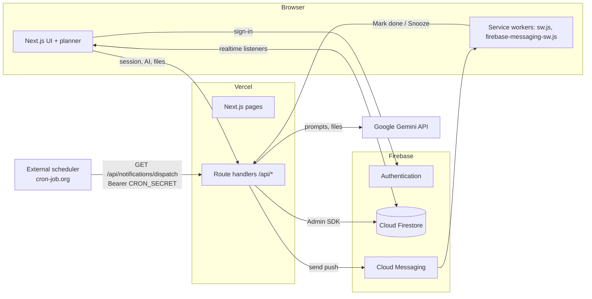

# Infrastructure

## Contents

| File | Purpose |
|---|---|
| [`.env.example`](.env.example) | Template of every environment variable. Copy to `../frontend/.env.local` for local work; add the same names in Vercel. |
| `../vercel.json` | Vercel build settings, kept at the repo root where Vercel reads it: framework `nextjs`, `npm install`, `npm run build`, output `frontend/.next`. No Vercel cron is configured. |
| `../firebase.json` | Firebase CLI config; rules and indexes live in `../backend/`. |
| `../.firebaserc` | Default Firebase project id. |

## Architecture



## Deploying

### 1. Firebase (once, then when rules change)

1. Create a project at <https://console.firebase.google.com> (the free Spark plan is enough; no Firebase Storage is used).
2. Authentication → Sign-in method: enable **Google** and **Email/Password**.
3. Build → Firestore Database → create a database (production mode).
4. Project settings → add a **Web app** and copy its config into the `NEXT_PUBLIC_FIREBASE_*` variables.
5. Project settings → Cloud Messaging → **Web Push certificates** → generate a key pair → `NEXT_PUBLIC_FIREBASE_VAPID_KEY`.
6. Project settings → Service accounts → **Generate new private key** → the three `FIREBASE_ADMIN_*` variables.
7. Deploy rules and indexes from the repo root:
   ```bash
   npm i -g firebase-tools
   firebase login
   # edit .firebaserc if your project id differs
   npm run deploy:firebase
   ```

### 2. Vercel

1. <https://vercel.com/new> → import the GitHub repository. Leave **Root Directory** empty (the repository root); `vercel.json`
   supplies the framework (`nextjs`), build command and `frontend/.next` output directory. Node.js version: 22.
2. Settings → Environment Variables: add every variable from `.env.example` (production, preview, development).
3. Deploy. Every push to `main` builds and deploys automatically (`npm run build`, which builds the `frontend` workspace and
   compiles `backend/` into it).

   *If Vercel cannot find the Next.js output:* in the project settings set **Root Directory** to `frontend`, keep
   "Include source files outside of the Root Directory" enabled (the backend lives in `../backend`), and clear the build and
   output overrides. Both setups build the same app.
4. Firebase → Authentication → Settings → **Authorised domains**: add the Vercel domain (`bubbleschedule.vercel.app` or your own).

### 3. Reminders

Push reminders are produced by `GET /api/notifications/dispatch`, which must be called regularly. Vercel's free plan allows
only daily cron jobs, so use an external scheduler such as [cron-job.org](https://cron-job.org):

- URL: `https://<your-domain>/api/notifications/dispatch`
- Interval: every 1–2 minutes
- Header: `Authorization: Bearer <CRON_SECRET>`

On a Vercel plan that allows it you can instead add to `vercel.json`:

```json
{ "crons": [{ "path": "/api/notifications/dispatch", "schedule": "*/2 * * * *" }] }
```

Without the scheduler the app still works; only background push (app closed) is affected. Reminders while the app is open
are produced by the page itself.

## Security notes

- Never commit `frontend/.env.local` (it is git-ignored). Only `.env.example` is tracked.
- `FIREBASE_ADMIN_PRIVATE_KEY` and `GEMINI_API_KEY` are server-only and never reach the browser.
- Firestore rules restrict every user to their own data; see `../backend/README.md`.
